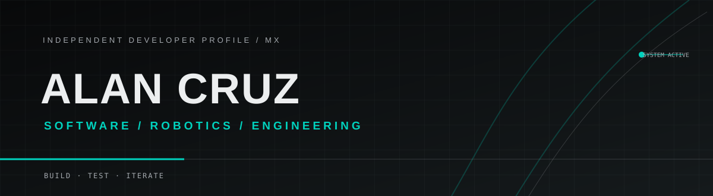

<!-- PROFILE BANNER -->

  

  <strong>SOFTWARE DEVELOPER</strong> &nbsp;·&nbsp; <strong>ROBOTICS</strong> &nbsp;·&nbsp; <strong>ENGINEERING</strong>

  Desarrollo de software con curiosidad por la ingeniería, la robótica y la tecnología.
   
  Me interesa construir soluciones, aprender mediante proyectos y conectar el mundo del software con sistemas físicos.

  <a href="https://github.com/Alan-JC">GitHub</a>
  &nbsp;·&nbsp;
  <a href="https://github.com/Alan-JC?tab=repositories">Projects</a>

---

## 01 / PROFILE

- **Focus:** desarrollo de software y aplicaciones.
- **Background:** robótica educativa y proyectos FIRST.
- **Interests:** automatización, electrónica, motorsport y tecnología.
- **Location:** México.

## 02 / TECHNOLOGY

  
  
  
  
  
  
  
  
  

## 03 / SELECTED WORK

| PROJECT | OVERVIEW |
|:--|:--|
| [rumbo-app](https://github.com/Alan-JC/rumbo-app) | Proyecto con estructura separada para frontend y backend. |
| [Proyecto_Aztlan](https://github.com/Alan-JC/Proyecto_Aztlan) | Proyecto organizado con datos, modelos, notebooks y código fuente. |
| [Labs](https://github.com/Alan-JC/Labs) | Colección de prácticas y ejercicios de programación. |

[Explore all repositories →](https://github.com/Alan-JC?tab=repositories)

## 04 / GITHUB METRICS

  
  

---

  BUILT WITH CURIOSITY · ALAN CRUZ · MÉXICO

